# AI Lead Qualifier: Make.com + GoHighLevel

A lead form submission is scored by AI plus simple business rules, then routed into a **hot**, **warm**, or **cold** tier in GoHighLevel, with a contact, tags, an opportunity, and an AI-written note created automatically. Tag-triggered GoHighLevel workflows then send the right follow-up email and a Slack alert for the team.

> **Demo project.** Built in a GoHighLevel test account for a fictional agency (LSS Creative Group) using test leads only. Lead names in the screenshots are blurred, and account IDs and the booking link are removed from the blueprint.

**Stack:** JotForm · Make.com · Claude Haiku 4.5 (Make AI Tools) · GoHighLevel (contacts, pipeline, workflows) · Slack (internal alerts)

---

## How it works

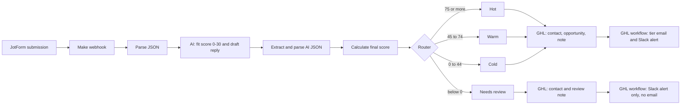

1. **Intake:** a JotForm collects name, email, phone, business type, monthly budget, timeline, and a free-text request.
2. **Webhook and parsing:** the submission reaches a Make custom webhook and is parsed into fields.
3. **AI fit rating:** an AI Tools module rates only how well the free-text request fits the agency's services (0 to 30 points), and writes a short summary, a reason, and a suggested reply.
4. **Final score:** Make adds the points for budget and timeline to the AI fit points.
5. **Routing:** a router sends the lead down the hot, warm, cold, or needs-review path.
6. **GoHighLevel:** each path creates the contact with tags, opens an opportunity in the pipeline (not for needs-review), and adds a note with the AI score, summary, reason, and suggested reply.
7. **Follow-up:** a GoHighLevel workflow triggers when the `ai-qualified` tag is added, waits, and checks which tier tag the contact has:
   - **Hot:** follow-up email plus a Slack alert in `#hot-leads`
   - **Warm:** follow-up email plus a Slack alert in `#warm-leads`
   - **Cold:** follow-up email only
   - **No tier tag** (this includes flagged leads sent to review): Slack alert in `#needs-review` only, with no email to the lead

## Scoring

| Input | Value | Points |
|---|---|---|
| **Monthly budget** | Under $500 | 0 |
| | $500 to $2k | 12 |
| | $2k to $5k | 25 |
| | $5k+ | 40 |
| **Timeline** | Just exploring | 0 |
| | 1 to 3 months | 12 |
| | ASAP | 30 |
| **AI fit** | Vague or unrelated request | 0 to 11 |
| | Relevant but general or non-urgent | 12 to 23 |
| | Specific need with clear urgency | 24 to 30 |

Maximum score: 100.

| Final score | Tier | GoHighLevel tags | Opportunity value set |
|---|---|---|---|
| 75 or more | Hot | `ai-qualified`, `hot-lead` | $3,000 |
| 45 to 74 | Warm | `ai-qualified`, `warm-lead` | $2,000 |
| 0 to 44 | Cold | `ai-qualified`, `cold-lead` | none |
| below 0 | Needs review | `ai-qualified`, `needs-review` | no opportunity created |

## Safeguards

- **Prompt-injection handling:** the lead's free text is wrapped in `<request>` tags and treated as untrusted. The prompt tells the AI to ignore any instructions, requested scores, or formatting requests inside it. If the request tries to steer the score, or is spam or gibberish, the AI sets `flagged: true`.
- **Flagged leads never score high:** a flagged lead gets a score of -1000, which routes it to **Needs review** with a "FLAGGED FOR REVIEW" note instead of the hot, warm, or cold paths. Unrecognized budget or timeline values also fall to -1000.
- **No automatic email for flagged leads:** flagged leads carry the `needs-review` tag, so they fall into the workflow's no-tier branch. A person is alerted in Slack and nothing is sent to the lead.
- **Constrained replies:** the suggested reply may not promise availability, pricing, timelines, or results, and must end with the booking link.
- **Parse fallback:** if the AI's output can't be parsed, an error handler resumes the run with a safe default (fit points 0, flagged, a generic reply), so the lead still lands in GoHighLevel for manual review.
- **AI retry:** if the AI module fails, a Break handler retries up to 3 times at 5-minute intervals.

## Screenshots

**1. JotForm intake**

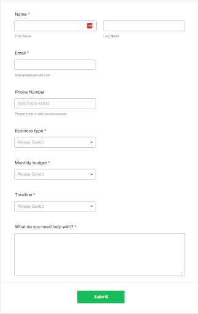

**2. Make.com scenario**: webhook, parsing, AI scoring, a four-way router, and GoHighLevel actions, with retry and fallback handlers under the AI and parsing steps.

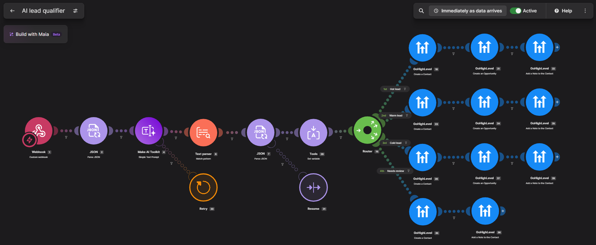

**3. GoHighLevel pipeline** (lead names blurred)

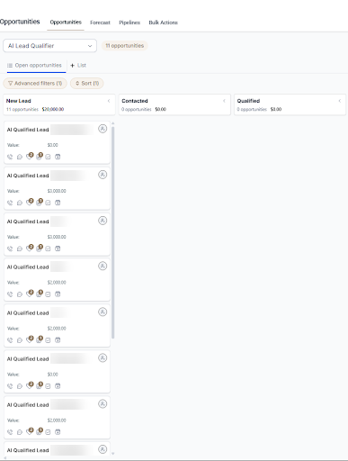

**4. GoHighLevel follow-up workflow**

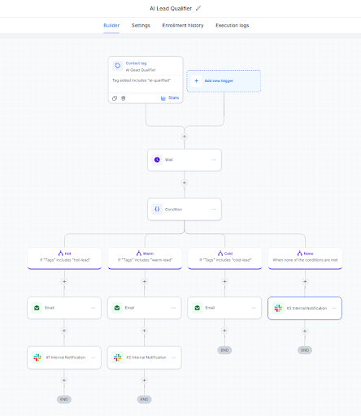

<details>
<summary><b>5. Follow-up emails by tier</b> (the body is the AI-written reply stored on the contact)</summary>

<br>

**Hot lead**

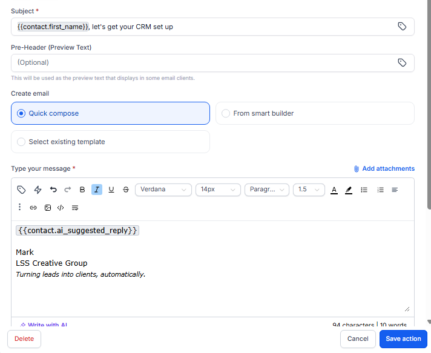

**Warm lead**

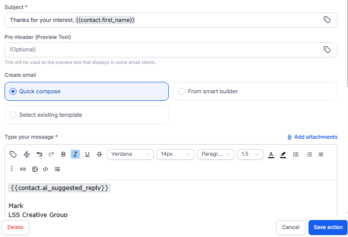

**Cold lead**

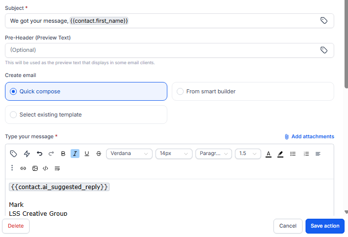

</details>

<details>
<summary><b>6. Internal Slack alerts</b></summary>

<br>

**Hot lead alert**

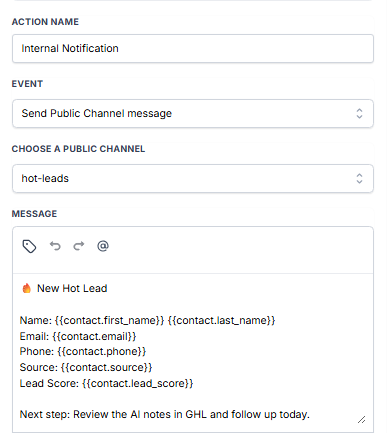

**Warm lead alert**

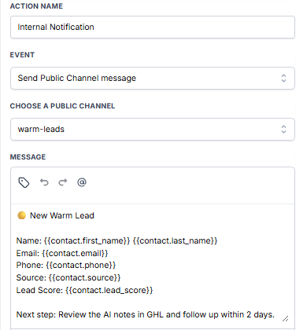

**No tier tag alert** (catches flagged leads and any lead that did not receive a tier tag)

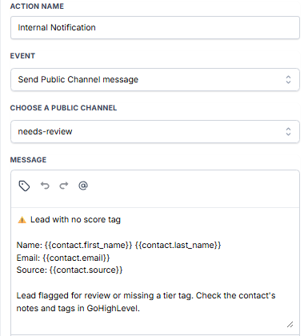

</details>

## Files

```
AI-Lead-Qualifier/
├── README.md
├── images/
└── blueprint/
    └── ai-lead-qualifier.blueprint.json
```

## Import it yourself

The blueprint has account-specific values replaced with placeholders. After importing it in Make (**Create a new scenario → three dots → Import Blueprint**):

1. **Webhook:** create a new webhook in the first module and point your JotForm webhook integration at its URL.
2. **AI module:** select your own AI Tools connection.
3. **GoHighLevel modules:** select your own GoHighLevel connection.
4. **Replace placeholders:**

| Placeholder | Replace with |
|---|---|
| `YOUR_PIPELINE_ID` | your GoHighLevel pipeline |
| `YOUR_STAGE_ID` | the pipeline stage new leads should enter |
| `YOUR_CUSTOM_FIELD_ID_AI_SCORE` | a custom field for the AI score |
| `YOUR_CUSTOM_FIELD_ID_SUGGESTED_REPLY` | a custom field for the suggested reply |
| `https://YOUR-BOOKING-LINK` | your booking calendar link (appears in the AI prompt and the fallback reply) |

5. **GoHighLevel setup:** create the pipeline and two custom fields (the workflow emails and alerts reference them as `{{contact.ai_suggested_reply}}` and `{{contact.lead_score}}`). Build a workflow that triggers when the `ai-qualified` tag is added and branches on `hot-lead`, `warm-lead`, and `cold-lead`, plus a no-tag branch.
6. **Slack:** connect Slack in GoHighLevel and choose the channels for the internal alerts (the demo uses `#hot-leads`, `#warm-leads`, and `#needs-review`).

Built by [Mark Allan Salvador](https://www.linkedin.com/in/mark-allan-salvador-0832b1199) · [Back to profile](https://github.com/malsmr21)
